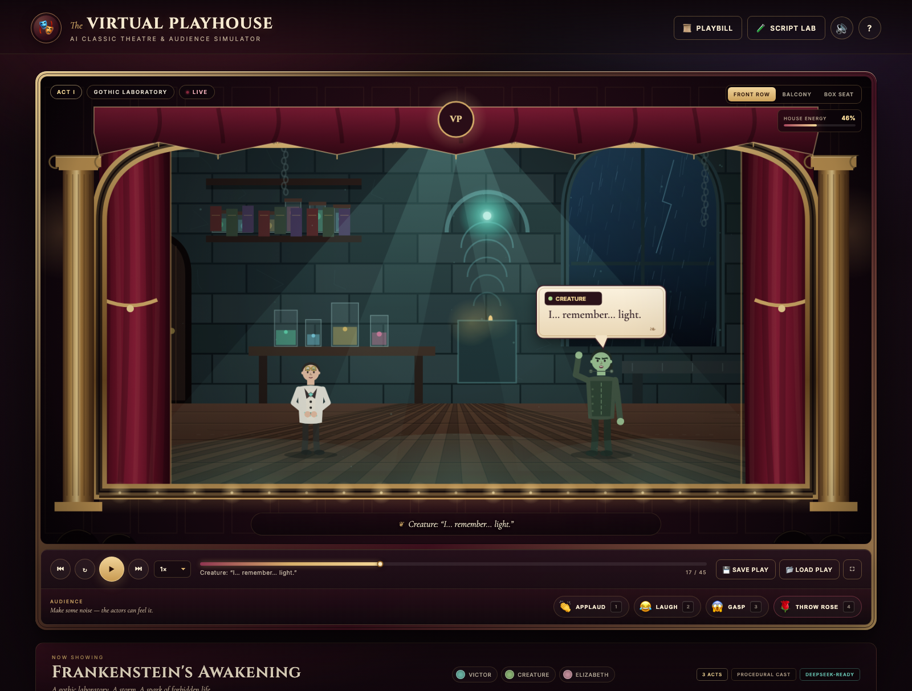

# 🎭 The Virtual Playhouse

**AI Classic Theatre & Audience Simulator**

A complete, production-ready theatre experience built with **vanilla HTML5, CSS3, ES6 JavaScript, HTML5 Canvas and the Web Audio API**. No frameworks, no build step, no image or sound assets — every curtain fold, spotlight, actor, sound cue and crowd reaction is generated live in the browser.

[](https://somphol.github.io/virtual-playhouse/)

> **Live performance:** https://somphol.github.io/virtual-playhouse/

---

## What is it?

You are in the audience of a small Victorian playhouse. Three classic acts are waiting in repertory:

| Act | Play | Setting |
| --- | --- | --- |
| **Act I** | *Frankenstein's Awakening* | A storm-torn Gothic laboratory |
| **Act II** | *The Mad Tea Party* | A Wonderland tea garden |
| **Act III** | *Hamlet on the Ramparts* | Elsinore at midnight |

Each act is a **JSON script** — stage directions, actor blocking, dialogue, lighting changes, sound cues and effects. The engine performs it on a 2.5D proscenium stage with procedural actors, animated typewriter speech bubbles, synthesized thunder, a live crowd and a curtain call.

Bring your own play by editing the JSON, loading a file, or asking **DeepSeek** to write one in the Script Lab.

---

## Features

### Stage & performance
- **2.5D proscenium stage** — ornate gilt frame, animated velvet curtains, wooden stage floor, overhead spotlights, footlights, dust motes and vignette.
- **Three hand-painted backdrops** (procedurally rendered and cached): Gothic Lab, Tea Party Garden and Castle Ramparts, plus a Grand Hall fallback.
- **Procedural 2.5D actors** with walk cycles, facing, gestures, kneeling, bows, talking mouths and costume-specific details.
- **Animated speech bubbles** with typewriter text, actor name tags, wrapping, tails and Web Audio typewriter clicks.
- **Lighting engine** — colour washes, three volumetric spotlights, floor pools, darkness falloff, lightning flashes and stage shake.
- **Particle effects** — sparks, lightning, fog, petals, confetti, embers, snow and playing cards.
- **Curtain call** — closing curtains, applause, confetti and an end card.

### Audience experience
- **Seat perspective toggle** — Front Row, Balcony and Box Seat each change the camera and add a different foreground (balcony rail, box drape, audience silhouettes).
- **Reaction bar** — 👏 Applaud, 😂 Laugh, 😱 Gasp and 🌹 Throw Rose trigger particles, crowd audio and raise the **House Energy** meter.
- **Playbill** — a paper programme with all three acts and their casts.
- **Transport controls** — play/pause, restart, previous/next act, playback speed and a clickable timeline/seek bar.

### Script engine
- Parses and validates script JSON with helpful errors and warnings.
- Accepts actors by id, full name or short name; missing cast entries are cast automatically.
- **Save** the current play as `theatre_play.json`.
- **Load** a play from a file or by dragging JSON onto the stage.
- **Script Lab** with a JSON editor, beautifier, validator and schema reference.
- **AI Playwright** — optional DeepSeek integration (key stays in your browser).
- 100% client-side.

### Sound
All audio is synthesized with the Web Audio API:
thunder, rain, wind, magic chimes, door creaks, heartbeats, clock ticks, bells, sword clashes, crowd gasps, laughter, applause and rose whooshes — plus a low ambient drone that changes with each act.

---

## Run it locally

No installation, no build step. Serve the folder with any static server:

```bash
cd virtual-playhouse
python3 -m http.server 8000
# open http://localhost:8000
```

You can also open `index.html` directly, though a local server is recommended so that file loading and API calls behave consistently.

---

## Controls

| Key | Action |
| --- | --- |
| `Space` | Play / pause |
| `←` / `→` | Previous / next act |
| `R` | Restart the act |
| `P` | Open the playbill |
| `S` | Open the Script Lab |
| `M` | Mute / unmute |
| `F` | Fullscreen stage |
| `H` | Help card |
| `1` | 👏 Applaud |
| `2` | 😂 Laugh |
| `3` | 😱 Gasp |
| `4` | 🌹 Throw a rose |

The first click or keypress unlocks the browser's audio context. Use the mute button (or `M`) to silence the house.

---

## Script format

A play is a single JSON object. The shortest useful script looks like this:

```json
{
  "title": "The Clockwork Nightingale",
  "act": "Special Engagement",
  "setting": "A workshop at midnight",
  "subtitle": "A maker meets the song he did not intend.",
  "backdrop": "grand_hall",
  "ambient": "wonderland",
  "cast": [
    {
      "id": "maker",
      "name": "The Clockmaker",
      "short": "Clockmaker",
      "costume": "scientist",
      "color": "#ffb36b",
      "position": "left",
      "height": 1
    },
    {
      "id": "bird",
      "name": "The Nightingale",
      "short": "Nightingale",
      "costume": "ghost",
      "color": "#73d7c4",
      "position": "right",
      "height": 1
    }
  ],
  "actions": [
    { "type": "CAPTION", "text": "A workshop at the edge of midnight." },
    { "type": "LIGHTING", "color": "#ffd27a", "intensity": 0.7 },
    { "type": "ENTER", "actor": "Clockmaker", "position": "left" },
    { "type": "ENTER", "actor": "Nightingale", "position": "right" },
    {
      "type": "DIALOGUE",
      "actor": "Clockmaker",
      "text": "I built you a heart of brass. I did not expect it to sing."
    },
    {
      "type": "DIALOGUE",
      "actor": "Nightingale",
      "text": "Then you built the wrong heart, and the right song."
    },
    { "type": "SOUND", "cue": "magic_chime" },
    { "type": "EFFECT", "effect": "petals" },
    { "type": "BOW", "actor": "Clockmaker" },
    { "type": "BOW", "actor": "Nightingale" }
  ]
}
```

### Action types

| Type | Fields | Purpose |
| --- | --- | --- |
| `ENTER` | `actor`, `position`, `from?` | Walk an actor on from the wings |
| `EXIT` | `actor` | Walk an actor off stage |
| `MOVE` | `actor`, `position` | Cross to a new mark |
| `FACE` | `actor`, `target` | Face another actor or the audience |
| `DIALOGUE` | `actor`, `text` | Speech bubble + typewriter + voice clicks |
| `LIGHTING` | `color`, `intensity` | Animate to a new lighting state |
| `SOUND` | `cue` | Fire a synthesized sound cue |
| `BACKDROP` | `backdrop` | Cross-fade the scenery |
| `EFFECT` | `effect` | Particles / lightning / fog |
| `GESTURE` | `actor`, `gesture` | Raise, point, beckon, recoil, clasp, kneel, talk |
| `BOW` | `actor` | Curtain-call bow |
| `CAPTION` | `text` | Stage-direction caption |
| `WAIT` / `PAUSE` | `duration` | Hold a beat |
| `CURTAIN` | `state` | Open or close the curtains |
| `AMBIENT` | `mood` | Change the ambient drone |

**Positions:** `"far-left"`, `"left"`, `"center-left"`, `"center"`, `"center-right"`, `"right"`, `"far-right"`, or a number from `0` to `1`.

**Sound cues:** `thunder_clap`, `rain`, `wind`, `magic_chime`, `door_creak`, `heartbeat`, `clock_tick`, `bell`, `sword_clash`, `crowd_gasp`, `applause`, `laugh`, `rose`.

**Effects:** `sparks`, `lightning`, `fog`, `petals`, `confetti`, `embers`, `snow`, `cards`.

**Backdrops:** `gothic_lab`, `tea_garden`, `ramparts`, `grand_hall`.

**Ambience:** `gothic`, `wonderland`, `tragedy`, `none`.

**Costumes:** `scientist`, `creature`, `alice`, `hatter`, `hare`, `queen`, `prince`, `ghost`, `royal`, `gown`, `default`.

---

## DeepSeek integration

Open **Script Lab → AI Playwright**:

1. Paste a DeepSeek API key. It is sent only to `https://api.deepseek.com/chat/completions` from your browser.
2. Choose a model. The default is **`deepseek-v4.1-flash`**; `deepseek-chat` and `deepseek-reasoner` are also suggested.
3. Describe the scene, choose a backdrop and temperature, then press **Generate Play**.
4. The returned JSON is validated and immediately staged.

The key is stored in `localStorage` only if you tick **Remember this key in this browser**. If the API blocks browser-origin requests, use **Copy Prompt** and paste the result into the JSON editor.

---

## Project structure

```text
virtual-playhouse/
├── index.html            # Semantic UI, HUD, modals, Script Lab
├── style.css             # Velvet-and-gilt design system, responsive layout
├── script.js             # Renderer, actors, audio, parser, playback, UI
├── assets/
│   └── preview.png       # Stage preview used in this README
├── state/
│   └── build-state.json  # Build time, token usage and credits
├── LICENSE
└── README.md
```

### How the engine fits together

- **Renderer** — `requestAnimationFrame` loop draws the theatre surround, clips the stage to the proscenium arch, applies the seat camera, then paints backdrop, floor, actors, effects, lighting, dust and bubbles.
- **Backdrops** — each scene is painted once into an offscreen canvas and cached; animated details (rain, stars, torch flames, lanterns, cards) are drawn on top each frame.
- **Actors** — procedural vector bodies with costume switches, walk cycles, pose timers, facing and typewriter-synced mouth movement.
- **Playback** — an action timeline with durations, pause/speed/seek, lighting and camera interpolation, curtain state and a parser that normalizes/validates external JSON.
- **Audio** — one lazily-created `AudioContext`, a noise buffer, oscillators and filters. No audio files.
- **UI** — playbill, Script Lab, help, toasts, keyboard shortcuts, drag-and-drop and responsive layout.

---

## Build receipt & credits

This project was designed, written, tested and published in a single session with:

- **OpenCode** — the agent harness that planned the build, wrote the files, ran the browser checks and published the repository.
- **DeepSeek V4.1 Flash** — the model behind the build.

The exact wall-clock build time, token consumption and session metadata are recorded in [`state/build-state.json`](state/build-state.json).

---

## License

MIT — see [LICENSE](LICENSE). The three classic plays are original short adaptations written for this simulator; the source characters and settings are in the public domain.
